<p align="center">
  
</p>

<p align="center">
  
</p>

<p align="center">
  <a href="https://www.linkedin.com/in/wilfredvincent/"></a>
  <a href="https://tasteio.in"></a>
  <a href="https://www.youtube.com/@k.Wilfredvincent"></a>
  <a href="https://www.instagram.com/k.wilfredvincent"></a>
  <a href="https://www.instagram.com/wilfred_irl"></a>
</p>

<p align="center">
  
</p>

---

## ⌘ About me

<p align="center"></p>

<table>
<tr>
<td valign="top">

**Wilfred** here. I lead brand and packaging for **Tasteio**, the in-house spice brand at **Princetouch Condiments**, my family's company in Kerala. I moved back from Toronto to help build it.

I'm not a software engineer. I'm learning to build with AI, one working piece at a time, and sharing the process as I go.

Right now I'm building a system that finds decision-makers at overseas importers and keeps track of every reply, quote and sample.

My goal is simple: take a tool that works for one family business and turn it into something other Indian exporters can use.

</td>
<td width="260" valign="middle">
  
</td>
</tr>
</table>

## ⌘ Tasteio

```text
> brand      Tasteio, by Princetouch Condiments
> origin     Palakkad, Kerala · family-run since 1997
> range      spices · masalas · pickles · gift boxes
> ships      across India and abroad
```

<a href="https://tasteio.in"></a>

## ⌘ Now building

```text
outreach_engine ........ [#######---] in progress
buyer_tracker .......... [########--] working prototype
buyerscope ............. [#---------] idea stage
```

## ⌘ Currently learning

```text
[~] databases ........... Supabase, Postgres
[~] automation .......... research and email outreach
[~] deliverability ...... SPF, DKIM, sending safely
[~] building with AI .... one piece at a time
```

## ⌘ Tools

<p align="center">
  
  
  
  
  
  
  
</p>

## ⌘ Statistics

<p align="center">
  
</p>

## ⌘ Commit activity

<p align="center">
  
</p>

## ⌘ Philosophy

<p align="center"><i>"Build the small thing that works, then build the next one."</i></p>

<p align="center"></p>
